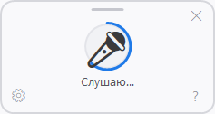
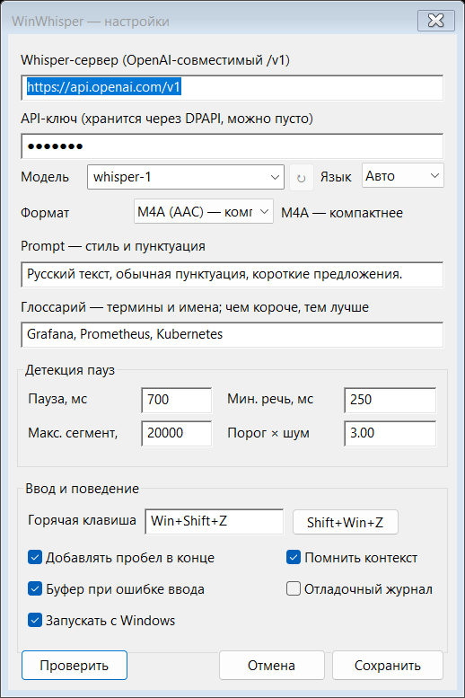

# 🎙 WinWhisper

**Голосовой ввод в любое поле Windows.** Нажали хоткей, сказали фразу, текст уехал туда, где стоит курсор —
в браузер, в редактор кода, в терминал, в мессенджер.

Нативная утилита в трее: один exe на 2.8 МБ, статический MFC, ни зависимостей, ни установщика.
Распознавание — любой **OpenAI-совместимый** Whisper (облако или свой локальный сервер).

[](https://github.com/rcktsci/WinWhisper/actions/workflows/build.yml)


<p align="center">
  
</p>

---

## ✨ Возможности

| | |
|---|---|
| 🪟 **Оверлей как в Win+H** | компактная панель 158×84 появляется у каретки, тянется за верхнюю полоску, есть шестерёнка и крестик |
| 🙈 **Не забирает фокус** | `WS_EX_NOACTIVATE`: курсор остаётся в вашем поле, ничего не переключается |
| ⌨️ **Глобальный хоткей** | по умолчанию `Win+Shift+Z`, меняется в настройках |
| ⏸ **Детекция пауз** | конец фразы по тишине, а не по таймеру; первый слог не теряется (pre-roll 300 мс), хвостовая тишина обрезается |
| 🔁 **Несколько фраз подряд** | одна сессия — сколько угодно фраз, панель не закрывается после каждой |
| 🛑 **Понятная остановка** | `ESC` (не долетает до приложения), любая реальная клавиша, переключение окна, повторный хоткей |
| 🧠 **Любой Whisper** | OpenAI, свой `faster-whisper`/`whisper.cpp`, любой совместимый шлюз |
| 📚 **Глоссарий** | список терминов и имён: модель пишет `Grafana`, `Prometheus`, `MiniMax` вместо «графана, Прометей Хьюз и Минемах» |
| 📋 **Список моделей из сервера** | диалог настроек сам запрашивает `/v1/models` и предлагает выпадающий список; речевые модели — сверху, но поле остаётся редактируемым |
| 🛡 **Защита от выдумок** | Whisper уверенно сочиняет текст на обрывках и шуме (классика жанра — «Субтитры создавал …»). Фраза проверяется по физике и уверенности модели и не попадает в документ |
| 🌍 **Смешанная речь** | русский + английский в одной фразе; раскладку переключать не нужно ни до, ни после |
| 🗜 **M4A/AAC** | в 5 раз меньше трафика, чем WAV; при отказе сервера — автоматический откат на WAV |
| 🔐 **Ключ под DPAPI** | API-ключ шифруется под учётную запись Windows, в открытом виде на диск не попадает |
| 📋 **Не теряет текст** | если окно не удалось активировать (например, оно с правами администратора) — текст уходит в буфер обмена |
| 🎤 **Любой микрофон** | WASAPI, сначала устройство по умолчанию, потом остальные; виртуальные «пустышки» пропускаются |
| 🚀 **Автозапуск при входе** | одним пунктом в трее, без установщика, служб и прав администратора; трей честно показывает, если запись выключили в Диспетчере задач или она осталась от другой копии |
| 🧰 **Мелочи** | трей, галочка «Добавлять пробел», отладочный журнал |

## 📊 Замеры, а не обещания

Всё измерено на живом сервере и реальном канале.

**Сжатие и задержка** (одна и та же фраза):

| Что отправляем | Размер сегмента | Круг на фразу |
|---|---|---|
| WAV (PCM 16 кГц) | 101 КБ | 1453–2312 мс |
| M4A (AAC 48 кбит/с) | 22 КБ | 922–1266 мс |
| M4A, соединение уже открыто | 17 КБ | **984 мс** |

**Глоссарий** (запись «Мы используем Grafana, Prometheus и MiniMax. Ещё z.ai и Claude»):

| Подсказка | Что вернулось |
|---|---|
| без глоссария | «Мы используем **графана, Промет Хьюз и Минемах**», «Ещё **z.aii.klon**» |
| 5–6 терминов | «Мы используем **Grafana, Prometheus и MiniMax**», «Ещё **z.ai, Claude**» ✅ |
| 12 терминов | «Мы используем Grafana, Prometheus и **Minimah**» — длинный список размывает влияние |

> Вывод: глоссарий должен быть **коротким и под текущую задачу** — 5–8 терминов работают заметно лучше двадцати.
> Технический предел подсказки у Whisper — ~224 токена (≈600 русских символов), лишнее молча отбрасывается с начала.

## 🔧 Как это работает

```
хоткей → WASAPI (микрофон) → ресемплер 16 кГц → детектор пауз → M4A → POST /audio/transcriptions → вставка текста
```

- **Пауза, а не поток.** Whisper не умеет стриминг, поэтому фраза уходит целиком после тишины. Это же даёт модели контекст и заметно улучшает качество на длинных фразах.
- **Pre-roll 300 мс.** Первые миллисекунды слова не теряются, даже если детектор сработал с задержкой.
- **Обрезка тишины с конца.** Иначе Whisper «слышит» в шуме комнаты несуществующие слова.
- **Один поток отправки.** Сегменты уходят и возвращаются в исходном порядке.
- **`WS_EX_NOACTIVATE` + низкоуровневые хуки.** Панель не крадёт фокус, но `ESC` и «любая клавиша» всё равно работают; собственный ввод приложения отличается от пользовательского по флагу `LLKHF_INJECTED`.
- **Перенос строки — всегда `Shift+Enter`.** Настройки для этого нет: надиктовать перенос на практике нельзя, любое перечисление модель отдаёт отдельными сегментами (проверено на синтезированной речи — 5 фраз, 0 переносов), а из двух вариантов безопасен только мягкий: обычный `Enter` отправил бы сообщение в чате и выполнил недописанную команду в терминале.

## 🚀 Сборка

Нужны **Visual Studio 2022 или 2026** (достаточно Build Tools) с компонентами:

- `Microsoft.VisualStudio.Component.VC.Tools.x86.x64`
- `Microsoft.VisualStudio.Component.VC.ATLMFC` — MFC
- Windows SDK 10.0.22621 или новее

```bat
build.bat            :: Release|x64
build.bat Debug      :: Debug|x64
```

или напрямую:

```bat
msbuild WinWhisper.vcxproj /p:Configuration=Release /p:Platform=x64 /m
```

Готовый файл — `x64\Release\WinWhisper.exe`. Проект по умолчанию просит тулсет `v145` (VS 2026);
на VS 2022 или в CI переопределяется так: `/p:PlatformToolset=v143`.

Готовые сборки лежат в [Releases](https://github.com/rcktsci/WinWhisper/releases) — exe прикладывается к каждому тегу автоматически.

## ⚙️ Настройка

Правый клик по иконке в трее → **Настройки…** (или шестерёнка в панели).

<p align="center">
  
</p>

| Поле | Смысл |
|---|---|
| Адрес сервера | база OpenAI-совместимого API, например `https://api.openai.com/v1` или `http://127.0.0.1:8000/v1` |
| API-ключ | хранится зашифрованным через DPAPI |
| Модель | `whisper-1` — универсальная и понимает подсказки; у некоторых серверов есть свои RU-модели. Поле с выпадающим списком: список тянется из `/v1/models`, кнопка «↻» обновляет его, а вписать имя руками можно всегда |
| Язык | «Автоопределение» удобнее: смешанная речь распознаётся без переключений |
| Формат отправки | M4A (компактнее) или WAV (без потерь) |
| Prompt | стиль: «Русский текст, обычная пунктуация, короткие предложения» |
| Глоссарий | термины и имена, которые должны распознаваться точно. Чем короче список, тем сильнее он влияет: 5–8 терминов работают заметно лучше двадцати |
| Пауза, мс | сколько тишины считать концом фразы. Хочется отзывчивее — 400–450 |
| Порог × шум | во сколько раз речь должна превысить фон. Шумно — поднять |

Настройки лежат в `%APPDATA%\WinWhisper\settings.ini`, журнал — рядом в `winwhisper.log`
(включается галочкой «Отладочный журнал»). **Аудио на диск не пишется вообще**, история текста не хранится.

## 🚀 Автозапуск при входе

Правый клик по иконке в трее → **Автозапуск при входе**. Ни установщика, ни службы, ни прав администратора:
приложение прописывает себя в `HKCU\...\CurrentVersion\Run` — так же, как любая обычная программа в трее.

```
HKCU\Software\Microsoft\Windows\CurrentVersion\Run
    WinWhisper = "C:\path\WinWhisper.exe" --autostart
```

Пункт меню показывает **настоящее** состояние, а не то, что записано в INI:

| Что видно в трее | Что это значит | Что сделает клик |
|---|---|---|
| ✅ Автозапуск при входе: включён | запись есть и указывает на эту копию | выключит |
| ✅ Автозапуск при входе: включён для другой копии | запись осталась от exe в другой папке | перепишет путь на эту копию |
| ☐ Автозапуск при входе: выключен в Диспетчере задач | запись есть, но Windows её пропускает | снимет блокировку, оставит включённой |
| ☐ Автозапуск при входе: выключен | записи нет | включит |

Два последних случая — не придирки. Диспетчер задач выключает автозапуск **не удаляя** запись: он кладёт
пометку в `Explorer\StartupApproved\Run`. Утилита, которая смотрит только в `Run`, продолжает уверять «я стартую
с Windows», пока Windows её молча пропускает. Приложение читает оба места, а трогает второе только когда там
действительно стоит блокировка.

Проверить без кликов, из скрипта:

```bat
WinWhisper.exe --autostart=on
WinWhisper.exe --autostart=off
WinWhisper.exe --selftest --offline   :: печатает текущее состояние автозапуска
```

## 🧪 Проверка без микрофона

```bat
:: настройки, расшифровка ключа, детектор пауз, доступность сервера
WinWhisper.exe --selftest
:: то же, но без обращения к сети (используется в CI)
WinWhisper.exe --selftest --offline

:: прогнать готовый WAV через тот же конвейер и напечатать распознанное
WinWhisper.exe --inject C:\path\to\speech.wav

:: отрисовать панель в PNG (для проверки вида, без всплывания на рабочем столе)
WinWhisper.exe --panel-shot docs\panel.png
WinWhisper.exe --panel-shot docs\panel@2x.png --dpi=144

:: то же для диалога настроек: разметку видно, не открывая его на экране
WinWhisper.exe --settings-shot docs\settings.png
WinWhisper.exe --settings-shot docs\settings.png --neutral   :: с примерными значениями, а не твоими

:: открыть настройки у уже запущенной копии (второй запуск будит первую)
WinWhisper.exe --settings

:: автозапуск при входе — то же, что пункт меню в трее
WinWhisper.exe --autostart=on
WinWhisper.exe --autostart=off
```

Отчёты: `%TEMP%\WinWhisper-selftest.txt` и `%TEMP%\WinWhisper-inject.txt`.

Вспомогательные скрипты в `tools\`:

- `make-icons.ps1` — перегенерировать иконки (чистая математика, без зависимостей);
- `ui-probe.ps1` — открыть панель хоткеем и сохранить её скриншот;
- `e2e-test.ps1` — сквозной прогон: Блокнот, синтез речи, проверка вставки.

## 🩺 Если что-то упало

В приложении стоит обработчик необработанных исключений, а Release-сборка несёт PDB, поэтому в
`%APPDATA%\WinWhisper\winwhisper.log` попадает не «0xC0000005 где-то там», а точное место:

```
[crash] exception 0xC0000005 at 0x00007FF76A4D9D8B
[crash] faulting 0x7FF76A4D9D8B = ModelsThread+0xEB (src\settings_dlg.cpp:83)
[crash] dump: C:\Users\...\AppData\Roaming\WinWhisper\crash.dmp
```

Рядом кладётся минидамп `crash.dmp` — открывается в Visual Studio или WinDbg. Именно так нашлось
падение в списке моделей: `unique_ptr::release()` и `job->owner` стояли в одном вызове, порядок
вычисления аргументов в C++ не определён, и компилятор обнулял указатель раньше, чем читал поле.

Если приложение **исчезло молча** — без дампа и без строки `WinWhisper exit`, — значит его закрыли снаружи
(`TerminateProcess`): такой способ не оставляет следов ни в приложении, ни в журнале Windows, ни в Defender.
Чтобы случай хотя бы датировался, приложение раз в минуту переписывает `%APPDATA%\WinWhisper\alive.txt`:

```
17:23:02 pid=17672 up=60с hotkey=да диктовка=0 — ожидание
```

Время последней записи этого файла — момент, когда приложение было живо в последний раз. Строки
`[exit] приложение закрывается штатно` и `WinWhisper exit` означают, что оно закрылось само
(трей → «Выход», завершение сеанса). Дополнительно приложение просит Windows поднять его после обновления
или падения (`RegisterApplicationRestart`), но ручное убийство этим не покрывается.

## ⚠️ Честные ограничения

- **Задержка 1–3 с** после паузы: Whisper не умеет стриминг, фраза уходит целиком. Первая фраза за запуск дополнительно платит за TLS-соединение.
- **Окна с правами администратора**: приложение работает `asInvoker`, поэтому `ESC` там не перехватывается (UIPI), а текст поедет через буфер обмена — но не потеряется.
- **Позиция панели** у браузеров и Electron-приложений иногда определяется по курсору: `GetGUIThreadInfo` про каретку там врёт.
- **Один получатель** — текст уйдёт в то окно, что было активно в момент нажатия хоткея.
- **Автозапуск и Defender**: exe не подписан, а поведенческая модель Defender не любит запись в `Run`. Копия
  приложения, запущенная из `%TEMP%`, один раз уехала в карантин как `Behavior:Win32/Persistence.A!ml`; та же
  сборка, включавшая автозапуск из своей папки, ни разу не была тронута. Если Defender всё-таки заругается —
  исключение на папку с exe или подпись кода закрывают вопрос окончательно.
- Только Windows.

## 🗺 Что дальше

- [ ] голосовые команды («удалить это», «новая строка», «нажми Enter»)
- [ ] ручной выбор микрофона в настройках
- [ ] откат последней вставки
- [ ] эхо-подавление, чтобы микрофон не слышал колонки
- [ ] пресеты глоссариев под разные проекты

## 📄 Лицензия

Лицензия пока не выбрана — по умолчанию все права reserved. Скажите, если нужна MIT/Apache-2.0.
